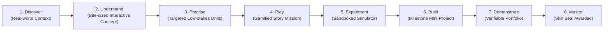

# Dronacharya — Project Overview & Strategic Blueprint

---

## 1. Executive Summary

**Dronacharya** is an AI-powered, gamified learning platform that bridges the gap between passive theoretical education and real-world practical mastery. Drawing philosophical inspiration from Guru Dronacharya of the Indian epic *Mahabharata*—the epitome of focused mentorship, deliberate practice, discipline, and uncompromising excellence—the platform digitizes the ancient Indian *Gurukul* model for 21st-century learners.

Instead of passively watching video lectures and memorizing syntax or formulas, students on Dronacharya embark on interactive, gamified missions, test concepts inside live sandboxed simulators, receive real-time Socratic guidance from an AI mentor, and build practical projects that form an auditable, verifiable digital portfolio.

---

## 2. Project Identity & Brand Rationale

### 2.1 The Name: Dronacharya
In Indian heritage, **Guru Dronacharya** represents the master educator who identifies the innate aptitude of his disciples and trains them to hit the eye of the bird (*ekagrata* - undivided focus). The platform embodies this timeless pedagogy:
- **Individualized Discernment:** Every learner has unique strengths and knowledge gaps; learning paths must adapt dynamically.
- **Mastery Through Rigor:** True competence is earned through continuous deliberate practice and challenging trials, not rote memorization.
- **The Modern Gurukul:** A sanctuary of calm, deep focus, intellectual respect, and mutual collaboration, unmarred by the noisy, flashy distractions of modern ed-tech.

### 2.2 Brand Guardrails
* **What Dronacharya Is:** An intellectual, premium, calm, Indian-heritage-inspired modern learning platform powered by cutting-edge AI and interactive simulators.
* **What Dronacharya Is NOT:**
  * Not a mythology or religious site (no sacred iconography, deities, or religious dogma).
  * Not a coaching-centre test-prep portal (no countdown exam timers screaming panic, no rote question-banks).
  * Not a flashy, neon cyberpunk video game (no candy-crush style dopamine hooks or garish rainbow interfaces).
  * Not a generic AI SaaS dashboard with purple gradients and floating cards.

---

## 3. The Problem Statement

### 3.1 The Passive Learning Crisis
The democratization of the internet has caused an information explosion: students have access to millions of YouTube tutorials, Massive Open Online Courses (MOOCs), PDFs, and interactive cheat sheets. Yet, industry readiness and practical problem-solving capabilities among graduates remain historically low.

The core systemic breakdowns are:
1. **The "Illusion of Competence":** Watching a skilled programmer code a full-stack application or an instructor build a machine learning model creates passive familiarity, which students mistake for mastery. When faced with a blank IDE or terminal, they freeze.
2. **Disconnected Theory & Practice:** Courses teach abstract syntax and textbook theorems in vacuum. Students are never shown *why* a particular data structure or economic formula matters in real production environments.
3. **One-Size-Fits-All Pacing:** Traditional online platforms treat all students identically. Fast learners grow bored; struggling learners get left behind and abandon courses (MOOC completion rates hover between 5% and 12%).
4. **Unhelpful, Delayed Feedback:** When a student makes a logical error, static auto-graders return opaque test failure messages (`Expected 42, got 17`). Without a mentor to identify the underlying misconception, students become frustrated.
5. **Resume Inflation & Unverifiable Credentials:** Traditional certificates of completion certify only that a video was streamed, not that skills were demonstrated. Employers increasingly discount online credentials due to rampant cheating and lack of verifiable project artifacts.

---

## 4. The Proposed Solution

Dronacharya completely reimagines the learning experience through six integrated solution pillars:

```
+-----------------------------------------------------------------------------------+
|                                  DRONACHARYA                                      |
+-----------------------------------------------------------------------------------+
|  1. AI Personalised Learning  |  2. Gamified Quests & Missions                    |
|     - Bayesian Knowledge Tracing |     - Story-driven progressive challenges       |
|     - Dynamic Path Synthesis     |     - Mastery Seals & fair skill-based XP      |
+-------------------------------+---------------------------------------------------+
|  3. Theory-to-Practice Sim    |  4. Acharya AI (Socratic Mentor)                  |
|     - WebAssembly Python Sandbox |     - 4-Tier Progressive Hinting (No Spoilers) |
|     - AI/ML & Business Modelers  |     - Trilingual: English, Hindi, Regional     |
+-------------------------------+---------------------------------------------------+
|  5. Real-World Projects       |  6. Gurukul Teams & Tournaments                   |
|     - Verifiable Portfolio Proof |     - Collaborative peer problem-solving       |
|     - Transparent Rubric Evals   |     - Constructive, fair cohort challenges     |
+-----------------------------------------------------------------------------------+
```

### 4.1 The Core Learning Journey
Every concept in Dronacharya follows an unbroken 8-stage pedagogical loop:



1. **Discover:** The student encounters a real-world scenario (e.g., "Why does an e-commerce checkout server crash during Diwali sales?").
2. **Understand:** The underlying theoretical concept (e.g., concurrency, rate limiting, and queues) is introduced through concise, interactive visualizations.
3. **Practise:** The student solves quick diagnostic puzzles to test foundational grasp.
4. **Play:** The concept is framed as a mission (e.g., "Stabilize the Virtual Courier Hub").
5. **Experiment:** The student tweaks parameters, changes variables, and breaks things safely in the **Theory-to-Practice Simulator**.
6. **Build:** The student authors a tangible mini-project applying the knowledge.
7. **Demonstrate:** Automated tests verify the implementation, creating an auditable digital artifact.
8. **Master:** A verifiable Skill Seal is minted to the student’s profile.

---

## 5. Target Audience & User Personas

| Persona | Archetype | Pain Points | Platform Value Proposition |
|:---|:---|:---|:---|
| **Aarav Sharma** (20) | Pre-final year Computer Science Engineering student | Consumed 50+ hours of tutorials; fails coding interviews; zero non-trivial projects on GitHub. | Sandboxed debugging simulator, progressive hints, and verifiable portfolio projects to show recruiters. |
| **Priya Patel** (23) | Non-tech graduate transitioning into Data Analytics | Overwhelmed by mathematical notation in ML courses; gets stuck on syntax bugs; feels isolated. | Multilingual AI mentor (Hindi/English code-switching), intuitive visual parameter sliders, bite-sized missions. |
| **Prof. Raghavan** (48) | Computer Science Department Head & Mentor | Struggles to identify which students need help; high dropout in coding labs; grading plagiarism. | Real-time mastery analytics, automated rubric evaluation, transparent skill evidence logs. |

---

## 6. Value Proposition & Key Differentiators

| Feature Dimension | Traditional MOOC (Coursera / Udemy) | Gamified Quiz Apps (Duolingo / Kahoot) | Dronacharya Platform |
|:---|:---|:---|:---|
| **Learning Modality** | Passive video streaming | Repetitive multiple-choice drills | **Interactive simulations + hands-on coding + missions** |
| **AI Role** | Generic chatbot answering FAQs | None or superficial hints | **Socratic Mentor (progressive nudges, misconception diagnosis)** |
| **Practical Validation** | Optional unverified quizzes | Multiple choice point farming | **Sandboxed runtime with real test execution and edge cases** |
| **Language Support** | Subtitles only | Flashcard translations | **Dynamic bilingual explanations (English & Hinglish code-switching)** |
| **Gamification Ethics** | None or simple badges | Addictive streak anxiety / hearts | **Skill mastery progression, anti-grind healthy limits** |
| **Credential Value** | Unverified attendance PDF | Point totals | **Verifiable cryptographic skill seals linking to code artifacts** |

---

## 7. Expected Impact & Metrics

### 7.1 Quantitative Impact
- **80%+ Practical Task Completion:** Transforming the typical 10% MOOC completion into an 80% task completion rate through interactive engagement.
- **3.5x Faster Debugging Competency:** Reducing the time novice learners spend paralyzed by compiler errors using Socratic guidance.
- **100% Verifiable Portfolios:** Every skill claimed on a student’s profile is backed by an inspectable code run, simulation state, or project repository.

### 7.2 Social & Inclusivity Impact
- Demystifying complex technical education across Tier-2 and Tier-3 colleges in India by providing high-quality mentorship in accessible Hindi and regional languages.
- Eliminating socioeconomic barriers by running sandboxed simulators directly in browser WebAssembly on budget laptops without requiring cloud server costs.

---

## 8. Hackathon Demonstration Goals

The target MVP demo will prove the feasibility of the end-to-end journey in **under 4 minutes**:
1. **Student Onboarding & Diagnostic:** Aarav signs up, picks "Python Algorithms & Data Structures", and takes a 3-question adaptive diagnostic.
2. **Adaptive Path Generation:** Dronacharya identifies a gap in "Recursion & Call Stacks" and generates a personalized 3-step learning mission.
3. **Interactive Mission & Sandbox:** Aarav plays "The Labyrinth of Fibonacci", writing recursive code in the sandboxed WebAssembly simulator.
4. **AI Mentor Socratic Guidance:** Aarav triggers a `RecursionError`. Instead of giving the answer, Acharya AI asks: *"What happens to your input when $n \le 1$? Look at your base case."*
5. **Project & Portfolio Demonstration:** Aarav fixes the code, passes the test suite, receives the "Master of Recursion" seal, and views the updated public portfolio with verified code proof.

---

## 9. Assumptions and Constraints

### 9.1 Technical Assumptions
1. Modern evergreen web browser support (Chrome, Firefox, Edge, Safari) with WebAssembly and Web Workers enabled for client-side code execution.
2. An accessible LLM API (Google Gemini 1.5 Pro / Flash) for natural language reasoning, structured JSON generation, and Socratic evaluation.
3. Initial MVP focus on **Computer Science / Python Programming** as the primary functional simulation, with conceptual UI blueprints for Business and AI/ML simulators.

### 9.2 Constraints
1. **Zero High-End Cloud Sandbox Costs:** For MVP scale, user code execution occurs client-side in the browser via Pyodide (WebAssembly), avoiding heavy backend container orchestration.
2. **API Rate Limits:** Intelligent client-side caching and session token management ensure LLM requests stay well within hackathon and freemium quota tiers.
