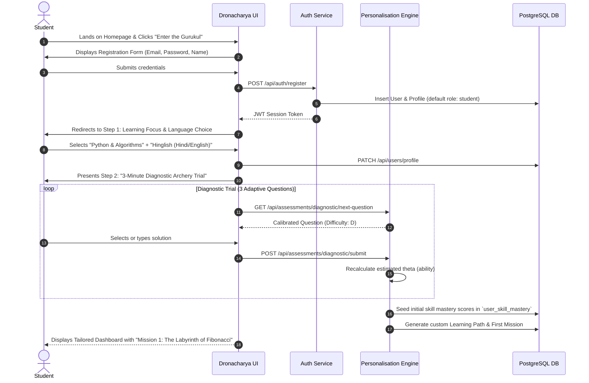
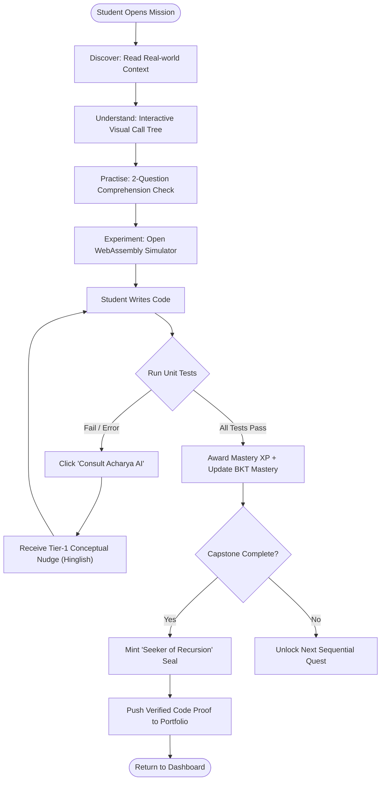
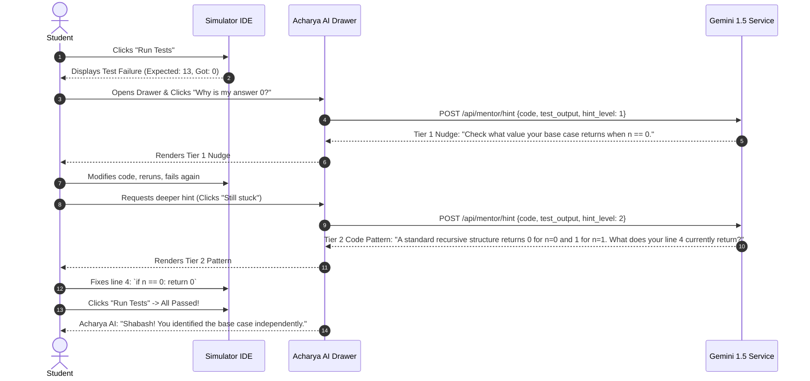
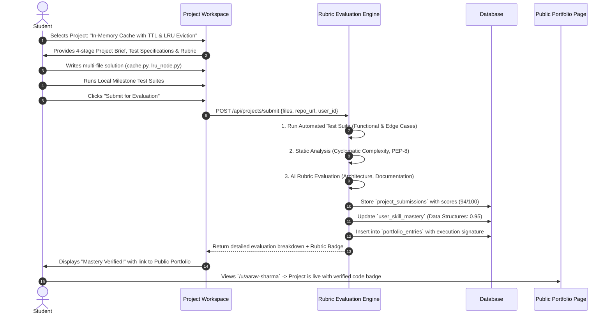
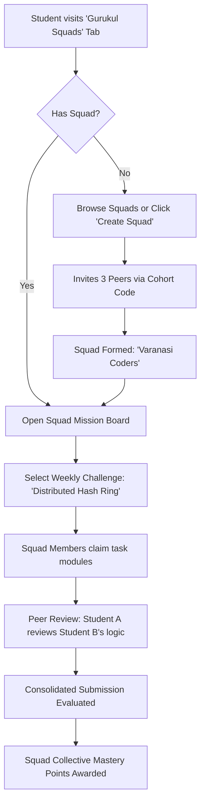
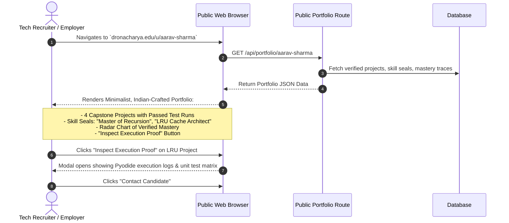

# Dronacharya — End-to-End User Journeys & Interaction Flows

---

## 1. Document Overview

This document specifies the primary student, mentor, and cohort user journeys through the **Dronacharya** platform. Every journey is mapped sequentially from user triggers to system actions, UI state transitions, and database updates, accompanied by comprehensive Mermaid flowcharts.

---

## 2. Journey 1: Student Onboarding & Diagnostic Assessment

### 2.1 Context & Objective
A new user arrives on Dronacharya, registers an account, configures learning preferences (focus track, preferred language), and completes a calibrated 3-question diagnostic assessment to establish their initial Knowledge Tracing baseline.



---

## 3. Journey 2: The Core Learning Loop (Discover to Build)

### 3.1 Step-by-Step Flow
1. **Discover:** The student opens *Mission 1: The Labyrinth of Fibonacci*. A narrative intro describes an automated postal distribution center in Varanasi struggling to optimize parcel routing using dynamic recursion.
2. **Understand:** The student reads a concise 2-minute visual briefing demonstrating recursive stack frames with an interactive call-tree slider.
3. **Practise:** A quick 2-question comprehension check validates the concept of a "Base Case" vs. "Recursive Step".
4. **Play & Experiment:** The student opens the integrated **Python WebAssembly Simulator**. The code template contains a skeleton function:
   ```python
   def route_cost(n: int) -> int:
       # TODO: Complete recursive calculation
       pass
   ```
5. **Debug with Acharya AI:** The student runs the code. A `RecursionError: maximum recursion depth exceeded` is thrown. The student clicks "Consult Acharya AI".
6. **Socratic Guidance:** Acharya AI observes the stack trace and provides a Tier-1 nudge in Hinglish:
   > *"Dhyan se dekho: jab $n$ kam hota jata hai, tumhara code kab rukta hai? Kya tumne base case likha hai?"*
7. **Build & Demonstrate:** The student implements `if n <= 1: return n`, clicks "Run Mission Tests". All 5 test cases pass.
8. **Mastery Seal:** 120 Mastery XP is awarded, and the skill seal **"Seeker of Recursion"** is unlocked on the student's profile.



---

## 4. Journey 3: Interacting with Acharya AI (Socratic Escalation)

This journey illustrates the strict non-spoiler escalation protocol enforced by Acharya AI when a student is stuck on a syntax or logic bug.



---

## 5. Journey 4: Real-World Capstone Project Submission & Rubric Evaluation



---

## 6. Journey 5: Squad Formation & Peer Collaboration (v1.1)



---

## 7. Journey 6: Public Portfolio Inspection by a Tech Recruiter


