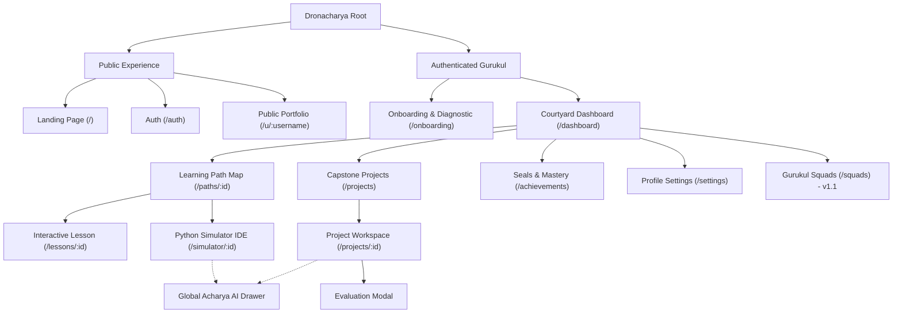
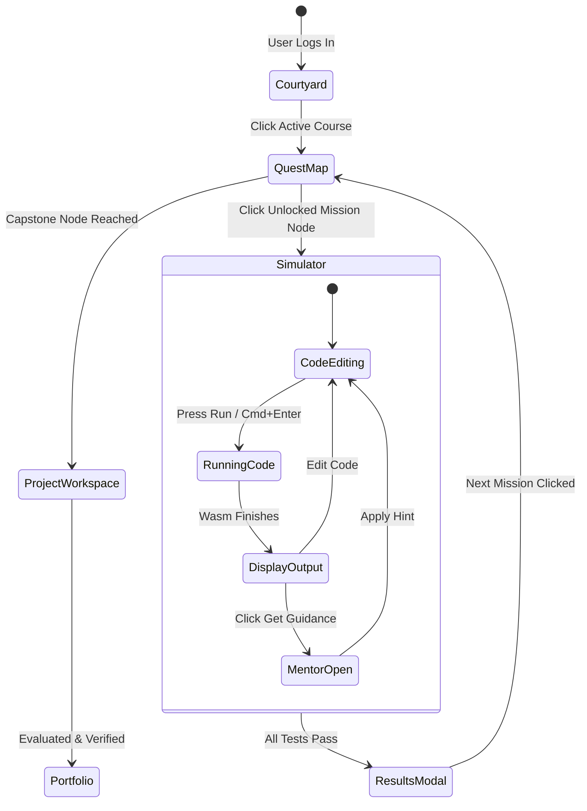

# Dronacharya — Design & Interaction Flows

---

## 1. Information Architecture (IA)

The information architecture of **Dronacharya** is structured around three primary zones: **The Courtyard (Global Dashboard)**, **The Learning Arena (Missions & Simulators)**, and **The Public Folio (Portfolios & Credentials)**.

---

## 2. Navigation Systems

### 2.1 Primary Navigation (Top Bar)
* **Desktop ($> 1024\text{px}$):**
  * *Left:* Dronacharya Mark (Bow & Arrow) + Wordmark.
  * *Center:* Breadcrumb / Zone Selector: `Courtyard` | `Learning Paths` | `Projects` | `Achievements`.
  * *Right:* Focus Streak Counter ($\text{Flame Icon} \times 7$), Daily XP Pill (`+240 XP`), Acharya AI Quick-Toggle, User Avatar dropdown.
* **Mobile & Tablet ($< 1024\text{px}$):**
  * *Top Bar:* Brand Mark + Active Page Title + Acharya AI Icon.
  * *Bottom Bar:* Fixed 4-item navigation: `Dashboard`, `Path`, `Projects`, `Profile`.

### 2.2 In-Simulator Contextual Navigation
When inside `SCREEN-SIM-01` or `SCREEN-PROJ-01`, standard page chrome is minimized to maximize code editing viewport:
* Back button returns directly to parent Quest Map node.
* Global navigation collapses into a discrete slide-out breadcrumb menu.

---

## 3. Modal and Drawer Interaction Behaviors

### 3.1 Acharya AI Drawer Behavior
* **Trigger:** Floating action button (`bottom-right`), keyboard shortcut (`Cmd + /` or `Ctrl + /`), or automated error diagnostic pill.
* **Animation:** Smooth slide from right: `transform: translateX(0)`, duration $250\text{ms}$, easing `cubic-bezier(0.16, 1, 0.3, 1)`.
* **Backdrop:** Non-blocking backdrop on desktop (allows editing code while drawer is open); light $20\%$ warm tint backdrop on mobile.
* **Focus Management:** Focus shifts immediately to the drawer input box; `Esc` key closes the drawer and restores focus to Monaco editor.

### 3.2 Challenge Results & Mastery Modal (`SCREEN-RSLT-01`)
* **Trigger:** Successful unit test execution where all cases pass.
* **Display Sequence:**
  1. Backdrop fades in (`opacity: 0.6`, Parchment-tinted dark overlay).
  2. Modal container scales from $0.95$ to $1.0$ ($200\text{ms}$).
  3. Antique Brass seal rotates $360^\circ$ into position.
  4. XP odometer counts up from previous score to updated score.
  5. Primary CTA ("Next Mission") auto-focused.

---

## 4. Keyboard Shortcuts & Accessibility Interactions

| Shortcut (Mac / Win) | Action | Scope |
|:---|:---|:---|
| `Cmd + Enter` / `Ctrl + Enter` | Run Python Code in Pyodide Sandbox | Simulator IDE |
| `Cmd + Shift + Enter` | Submit Mission for Formal Evaluation | Simulator IDE |
| `Cmd + /` / `Ctrl + /` | Open / Close Acharya AI Mentor Drawer | Global |
| `Esc` | Close active Modal, Drawer, or Dropdown | Global |
| `Alt + 1` | Request Tier-1 Conceptual Nudge | Inside Simulator |
| `Alt + 2` | Request Tier-2 Structural Pattern | Inside Simulator |
| `Tab` / `Shift + Tab` | Trap focus inside active modal dialogs | Modals |

---

## 5. Screen Transition Architecture

