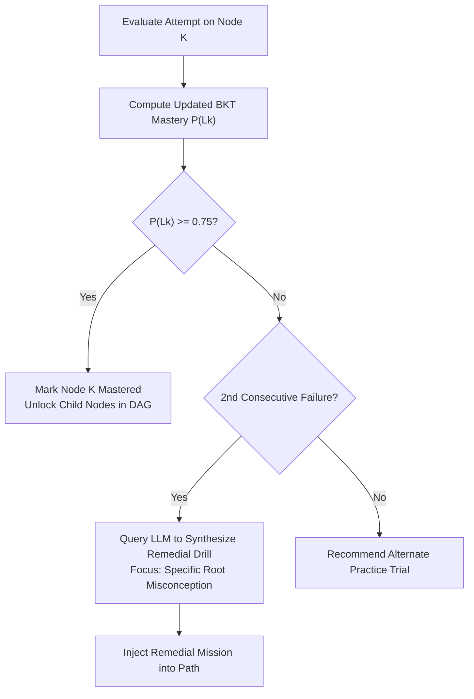

# Dronacharya — AI Architecture & Adaptive Personalisation Engine

---

## 1. Mathematical Knowledge Modeling: Bayesian Knowledge Tracing (BKT)

To ensure personalisation is anchored in observable student performance rather than arbitrary guesses, Dronacharya implements a deterministic **Bayesian Knowledge Tracing (BKT)** algorithm paired with an LLM-based pedagogical orchestrator.

### 1.1 Standard BKT Parameters
For every atomic skill node $k$ (e.g., `recursion.base_case`, `data_structures.hash_map`), the system tracks:
* $P(L_0)$: Prior probability that the student knows the skill initially (default: $0.15$ or initialized via diagnostic).
* $P(T)$: Probability that the student learns the skill on an attempt (default: $0.20$).
* $P(G)$: Probability that the student guesses correctly without knowing the skill (default: $0.10$).
* $P(S)$: Probability that the student makes a slip/mistake despite knowing the skill (default: $0.05$).

### 1.2 Posterior Mastery Update Formula
Upon receiving an attempt outcome $O_t \in \{1 (\text{correct}), 0 (\text{incorrect})\}$:

$$\text{If } O_t = 1: \quad P(L_t | O_t=1) = \frac{P(L_{t-1}) \cdot (1 - P(S))}{P(L_{t-1}) \cdot (1 - P(S)) + (1 - P(L_{t-1})) \cdot P(G)}$$

$$\text{If } O_t = 0: \quad P(L_t | O_t=0) = \frac{P(L_{t-1}) \cdot P(S)}{P(L_{t-1}) \cdot P(S) + (1 - P(L_{t-1})) \cdot (1 - P(G))}$$

$$\text{Transition to next step:} \quad P(L_{t}) = P(L_t | O_t) + (1 - P(L_t | O_t)) \cdot P(T)$$

### 1.3 Knowledge Tracing Implementation in TypeScript

```typescript
export interface BKTParameters {
  p_l0: number; // Initial mastery
  p_t: number;  // Transition probability
  p_g: number;  // Guess probability
  p_s: number;  // Slip probability
}

export function updateBKT(
  priorMastery: number,
  isCorrect: boolean,
  hintsUsedCount: number,
  params: BKTParameters = { p_l0: 0.15, p_t: 0.20, p_g: 0.10, p_s: 0.05 }
): number {
  // Penalty factor if student relied on progressive hints
  const effectiveCorrect = isCorrect && hintsUsedCount === 0;
  const { p_t, p_g, p_s } = params;

  let posterior: number;
  if (effectiveCorrect) {
    posterior = (priorMastery * (1 - p_s)) / (priorMastery * (1 - p_s) + (1 - priorMastery) * p_g);
  } else {
    // If hints were used or answer was wrong, treated as non-mastered evidence
    posterior = (priorMastery * p_s) / (priorMastery * p_s + (1 - priorMastery) * (1 - p_g));
  }

  // Calculate projected mastery for next trial
  const nextMastery = posterior + (1 - posterior) * p_t;
  return Math.min(0.99, Math.max(0.01, Number(nextMastery.toFixed(4))));
}
```

---

## 2. Dynamic Learning Path Synthesis

When a student finishes a mission or assessment, the system queries their current skill vector:
* **Mastery Threshold:** If $P(L_k) \ge 0.75$, the node is considered **Mastered**, unlocking subsequent nodes in the Directed Acyclic Graph (DAG).
* **Remediation Trigger:** If $P(L_k) < 0.60$ across two consecutive attempts, the engine synthesizes an intermediate **Remedial Practice Quest** targeting the specific misconception.



---

## 3. Structured Prompt Engineering & JSON Validation

All interactions with LLMs (Google Gemini 1.5 Pro / Flash) enforce strict JSON schemas via system instructions and response format constraints to prevent markdown breakage and hallucinations.

### 3.1 Prompt Schema: Adaptive Remedial Challenge Generation

```json
{
  "system_instruction": "You are Dronacharya's Curriculum Architect. Generate a focused, single-concept Python programming mission to correct a student's identified misconception. Return ONLY valid JSON matching the schema.",
  "input_context": {
    "topic": "recursion",
    "failed_concept": "base_case_termination",
    "observed_error": "RecursionError: maximum recursion depth exceeded",
    "language_preference": "hinglish",
    "student_skill_level": "beginner"
  },
  "expected_schema": {
    "type": "object",
    "properties": {
      "mission_title": { "type": "string" },
      "narrative_context": { "type": "string" },
      "concept_explanation": { "type": "string" },
      "starter_code": { "type": "string" },
      "solution_pattern": { "type": "string" },
      "test_cases": {
        "type": "array",
        "items": {
          "type": "object",
          "properties": {
            "input": { "type": "string" },
            "expected_output": { "type": "string" },
            "is_hidden": { "type": "boolean" }
          },
          "required": ["input", "expected_output", "is_hidden"]
        }
      }
    },
    "required": ["mission_title", "narrative_context", "concept_explanation", "starter_code", "test_cases"]
  }
}
```

---

## 4. Cost Control, Caching & Fallback Protocols

### 4.1 Tiered Caching Strategy
1. **Deterministic Static Cache:** High-frequency concept explanations and standard diagnostic questions are stored in a distributed Redis/Vercel KV store (TTL: 7 days).
2. **Hash-Based Semantic Cache:** LLM hint queries are indexed by `sha256(concept_id + error_type + hint_tier)`. If a prior student encountered the exact same syntax error on line 4, the cached Socratic response is served in $<50\text{ms}$ at $\$0.00$ API cost.

### 4.2 Fallback Rules
If the external LLM API experiences rate-limiting (HTTP 429) or outage (HTTP 503):
1. **Fallback Rule 1 (Static Guidance):** System displays pre-compiled pedagogical rulebooks:
   > *"Acharya AI is contemplating. Hint: Check your function's return statement when the input list is empty."*
2. **Fallback Rule 2 (Client Continuity):** Code execution inside the Pyodide WebAssembly sandbox continues uninhibited without dependency on cloud AI uptime.
