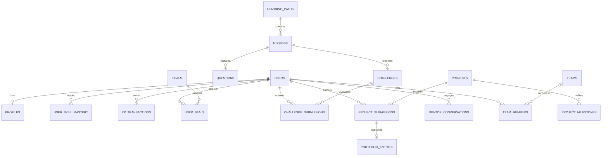

# Dronacharya — Database Schema Specification & DDL SQL

---

## 1. Entity Relationship Overview

The **Dronacharya** data architecture is structured around clean relational domains: Identity & Profiles, Curriculum & Quests, Assessment & Knowledge Tracing, Submissions & Sandboxes, Gamification & Seals, and Social Cohorts.



---

## 2. PostgreSQL DDL Schema Script

```sql
-- Dronacharya Relational Schema (PostgreSQL 15+)
-- Enable UUID extension
CREATE EXTENSION IF NOT EXISTS "uuid-ossp";

-- 1. Users Table (Core Identity)
CREATE TABLE users (
    id UUID PRIMARY KEY DEFAULT uuid_generate_v4(),
    email VARCHAR(255) UNIQUE NOT NULL,
    password_hash VARCHAR(255) NOT NULL,
    created_at TIMESTAMP WITH TIME ZONE DEFAULT CURRENT_TIMESTAMP,
    updated_at TIMESTAMP WITH TIME ZONE DEFAULT CURRENT_TIMESTAMP
);

-- 2. Profiles Table (Gurukul Learner Metadata)
CREATE TYPE learner_role AS ENUM ('student', 'mentor', 'admin');
CREATE TYPE language_preference AS ENUM ('en', 'hi', 'hinglish');

CREATE TABLE profiles (
    user_id UUID PRIMARY KEY REFERENCES users(id) ON DELETE CASCADE,
    username VARCHAR(50) UNIQUE NOT NULL,
    full_name VARCHAR(100) NOT NULL,
    avatar_url TEXT,
    bio TEXT,
    role learner_role DEFAULT 'student',
    preferred_lang language_preference DEFAULT 'hinglish',
    total_xp INTEGER DEFAULT 0 CHECK (total_xp >= 0),
    current_streak INTEGER DEFAULT 0 CHECK (current_streak >= 0),
    grace_freezes_available INTEGER DEFAULT 1 CHECK (grace_freezes_available >= 0),
    last_active_date DATE DEFAULT CURRENT_DATE,
    created_at TIMESTAMP WITH TIME ZONE DEFAULT CURRENT_TIMESTAMP
);

-- 3. Skills & Topics Master Catalog
CREATE TABLE skills (
    id VARCHAR(50) PRIMARY KEY, -- e.g., 'py.recursion.base_case'
    domain VARCHAR(50) NOT NULL, -- e.g., 'Computer Science'
    name VARCHAR(100) NOT NULL,
    description TEXT,
    prerequisite_skill_id VARCHAR(50) REFERENCES skills(id),
    created_at TIMESTAMP WITH TIME ZONE DEFAULT CURRENT_TIMESTAMP
);

-- 4. User Skill Mastery (Bayesian Knowledge Tracing State)
CREATE TABLE user_skill_mastery (
    id UUID PRIMARY KEY DEFAULT uuid_generate_v4(),
    user_id UUID NOT NULL REFERENCES users(id) ON DELETE CASCADE,
    skill_id VARCHAR(50) NOT NULL REFERENCES skills(id),
    mastery_probability NUMERIC(5, 4) DEFAULT 0.1500 CHECK (mastery_probability BETWEEN 0.0 AND 1.0),
    attempts_count INTEGER DEFAULT 0,
    last_practiced_at TIMESTAMP WITH TIME ZONE DEFAULT CURRENT_TIMESTAMP,
    UNIQUE(user_id, skill_id)
);

-- 5. Learning Paths & Quests
CREATE TABLE learning_paths (
    id VARCHAR(50) PRIMARY KEY, -- e.g., 'python-core-mastery'
    title VARCHAR(150) NOT NULL,
    slug VARCHAR(150) UNIQUE NOT NULL,
    description TEXT NOT NULL,
    target_role VARCHAR(100),
    is_published BOOLEAN DEFAULT true,
    created_at TIMESTAMP WITH TIME ZONE DEFAULT CURRENT_TIMESTAMP
);

CREATE TABLE missions (
    id VARCHAR(50) PRIMARY KEY, -- e.g., 'mission-fib-labyrinth'
    path_id VARCHAR(50) NOT NULL REFERENCES learning_paths(id) ON DELETE CASCADE,
    sequence_order INTEGER NOT NULL,
    title VARCHAR(150) NOT NULL,
    narrative_context TEXT NOT NULL,
    concept_briefing TEXT NOT NULL,
    xp_reward INTEGER DEFAULT 120,
    primary_skill_id VARCHAR(50) REFERENCES skills(id),
    created_at TIMESTAMP WITH TIME ZONE DEFAULT CURRENT_TIMESTAMP
);

-- 6. Interactive Challenges (Simulator Problems)
CREATE TABLE challenges (
    id VARCHAR(50) PRIMARY KEY,
    mission_id VARCHAR(50) UNIQUE NOT NULL REFERENCES missions(id) ON DELETE CASCADE,
    initial_code TEXT NOT NULL,
    solution_code TEXT NOT NULL,
    visible_tests JSONB NOT NULL, -- [{ input: "5", expected: "5" }]
    hidden_tests JSONB NOT NULL,  -- Edge cases executed server/worker side
    execution_timeout_ms INTEGER DEFAULT 5000,
    created_at TIMESTAMP WITH TIME ZONE DEFAULT CURRENT_TIMESTAMP
);

-- 7. Challenge Submissions
CREATE TABLE challenge_submissions (
    id UUID PRIMARY KEY DEFAULT uuid_generate_v4(),
    user_id UUID NOT NULL REFERENCES users(id) ON DELETE CASCADE,
    challenge_id VARCHAR(50) NOT NULL REFERENCES challenges(id),
    submitted_code TEXT NOT NULL,
    passed_all_tests BOOLEAN NOT NULL,
    tests_passed_count INTEGER NOT NULL,
    tests_total_count INTEGER NOT NULL,
    execution_time_ms NUMERIC(8, 2),
    hints_used_count INTEGER DEFAULT 0,
    created_at TIMESTAMP WITH TIME ZONE DEFAULT CURRENT_TIMESTAMP
);

-- 8. Gamification: Seals & XP Transactions
CREATE TABLE seals (
    id VARCHAR(50) PRIMARY KEY, -- e.g., 'seal-recursive-archer'
    title VARCHAR(100) NOT NULL,
    description TEXT NOT NULL,
    icon_svg_url TEXT NOT NULL,
    required_skill_id VARCHAR(50) REFERENCES skills(id),
    created_at TIMESTAMP WITH TIME ZONE DEFAULT CURRENT_TIMESTAMP
);

CREATE TABLE user_seals (
    id UUID PRIMARY KEY DEFAULT uuid_generate_v4(),
    user_id UUID NOT NULL REFERENCES users(id) ON DELETE CASCADE,
    seal_id VARCHAR(50) NOT NULL REFERENCES seals(id),
    verification_hash VARCHAR(64) NOT NULL, -- SHA-256 cryptographic proof
    awarded_at TIMESTAMP WITH TIME ZONE DEFAULT CURRENT_TIMESTAMP,
    UNIQUE(user_id, seal_id)
);

CREATE TABLE xp_transactions (
    id UUID PRIMARY KEY DEFAULT uuid_generate_v4(),
    user_id UUID NOT NULL REFERENCES users(id) ON DELETE CASCADE,
    amount INTEGER NOT NULL CHECK (amount != 0),
    activity_type VARCHAR(50) NOT NULL, -- 'mission_pass', 'capstone_eval', 'peer_review'
    reference_id VARCHAR(100),
    created_at TIMESTAMP WITH TIME ZONE DEFAULT CURRENT_TIMESTAMP
);

-- 9. Acharya AI Socratic Conversations
CREATE TABLE mentor_conversations (
    id UUID PRIMARY KEY DEFAULT uuid_generate_v4(),
    user_id UUID NOT NULL REFERENCES users(id) ON DELETE CASCADE,
    mission_id VARCHAR(50) REFERENCES missions(id),
    hint_tier_reached INTEGER DEFAULT 1 CHECK (hint_tier_reached BETWEEN 1 AND 4),
    messages JSONB NOT NULL, -- [{ role: 'user'|'assistant', content: string, timestamp: string }]
    created_at TIMESTAMP WITH TIME ZONE DEFAULT CURRENT_TIMESTAMP,
    updated_at TIMESTAMP WITH TIME ZONE DEFAULT CURRENT_TIMESTAMP
);

-- 10. Capstone Projects & Public Portfolio
CREATE TABLE projects (
    id VARCHAR(50) PRIMARY KEY,
    title VARCHAR(150) NOT NULL,
    description TEXT NOT NULL,
    rubric_spec JSONB NOT NULL, -- Dimensions: Functionality, Complexity, Style
    template_repo_url TEXT,
    created_at TIMESTAMP WITH TIME ZONE DEFAULT CURRENT_TIMESTAMP
);

CREATE TABLE project_submissions (
    id UUID PRIMARY KEY DEFAULT uuid_generate_v4(),
    user_id UUID NOT NULL REFERENCES users(id) ON DELETE CASCADE,
    project_id VARCHAR(50) NOT NULL REFERENCES projects(id),
    repo_url TEXT NOT NULL,
    total_score NUMERIC(5, 2) NOT NULL, -- 0.00 to 100.00
    rubric_breakdown JSONB NOT NULL,
    mentor_feedback TEXT,
    is_verified BOOLEAN DEFAULT false,
    submitted_at TIMESTAMP WITH TIME ZONE DEFAULT CURRENT_TIMESTAMP
);

CREATE TABLE portfolio_entries (
    id UUID PRIMARY KEY DEFAULT uuid_generate_v4(),
    user_id UUID NOT NULL REFERENCES users(id) ON DELETE CASCADE,
    project_submission_id UUID NOT NULL REFERENCES project_submissions(id),
    featured_order INTEGER DEFAULT 1,
    is_public BOOLEAN DEFAULT true,
    created_at TIMESTAMP WITH TIME ZONE DEFAULT CURRENT_TIMESTAMP
);

-- 11. Gurukul Squads (Cohorts)
CREATE TABLE teams (
    id UUID PRIMARY KEY DEFAULT uuid_generate_v4(),
    name VARCHAR(100) NOT NULL,
    join_code VARCHAR(12) UNIQUE NOT NULL,
    created_by UUID REFERENCES users(id),
    collective_xp INTEGER DEFAULT 0,
    created_at TIMESTAMP WITH TIME ZONE DEFAULT CURRENT_TIMESTAMP
);

CREATE TABLE team_members (
    team_id UUID NOT NULL REFERENCES teams(id) ON DELETE CASCADE,
    user_id UUID NOT NULL REFERENCES users(id) ON DELETE CASCADE,
    role VARCHAR(20) DEFAULT 'member', -- 'leader', 'member'
    joined_at TIMESTAMP WITH TIME ZONE DEFAULT CURRENT_TIMESTAMP,
    PRIMARY KEY(team_id, user_id)
);

-- Essential Performance Indexes
CREATE INDEX idx_user_skill_mastery_lookup ON user_skill_mastery(user_id, skill_id);
CREATE INDEX idx_submissions_user_challenge ON challenge_submissions(user_id, challenge_id);
CREATE INDEX idx_xp_tx_user_date ON xp_transactions(user_id, created_at DESC);
CREATE INDEX idx_portfolio_public ON portfolio_entries(user_id) WHERE is_public = true;
```

---

## 3. Data Privacy & Compliance (DPDP Act 2023)

1. **Minimization of PII:** Only email and user-supplied display names are stored. No phone numbers, real-world physical addresses, or financial data are requested.
2. **Right to Erasure (Soft vs. Hard Deletion):** Deleting an account executes a cascade purge on `users`, removing all personal records, while anonymized, aggregated learning error logs are retained for curriculum calibration.
